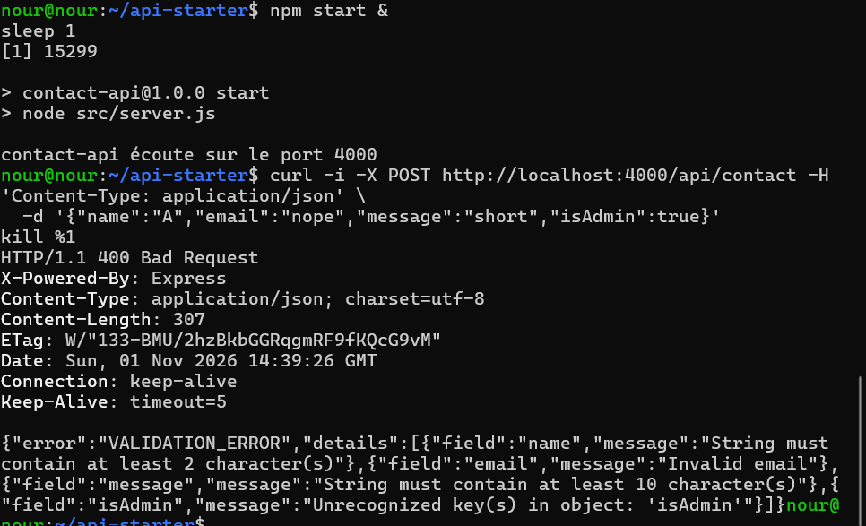
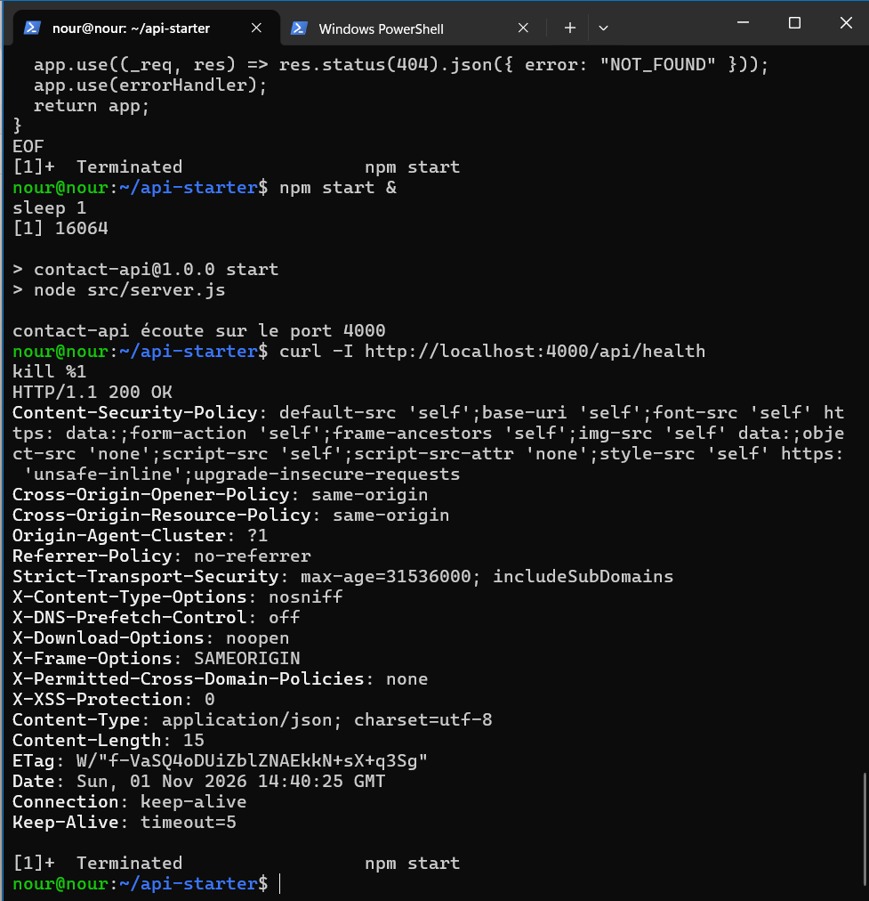
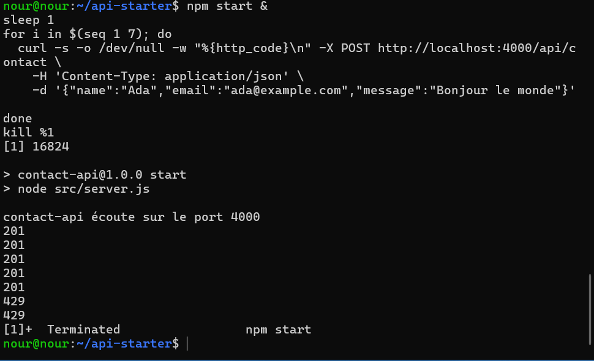
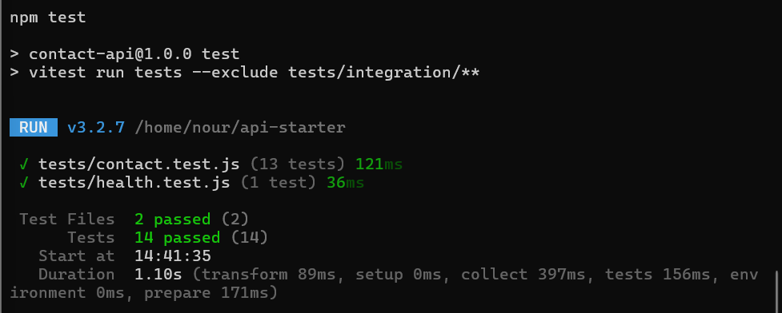
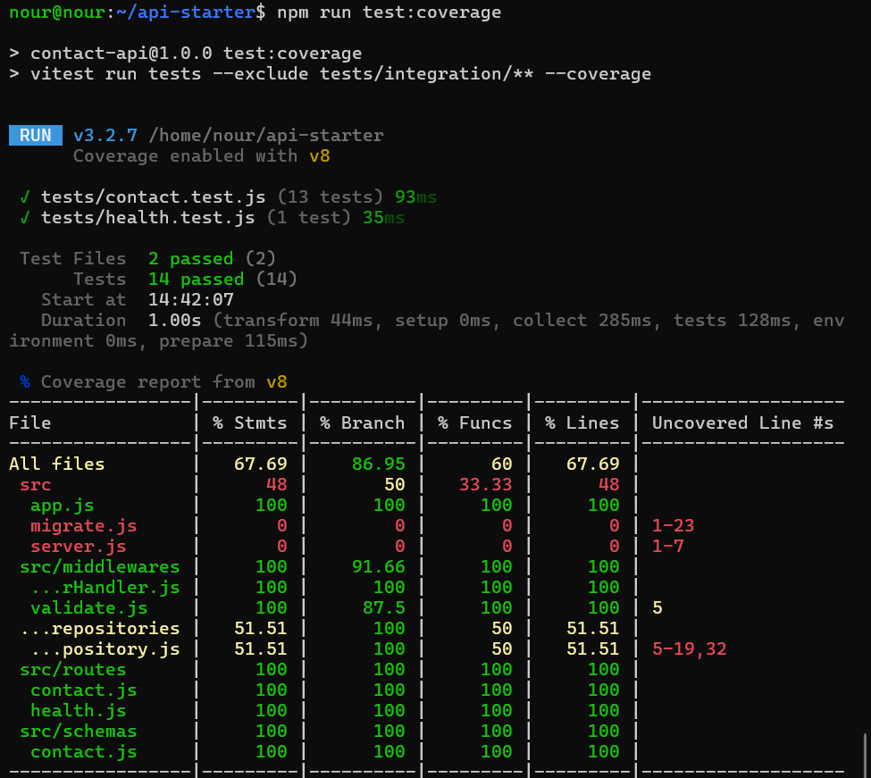
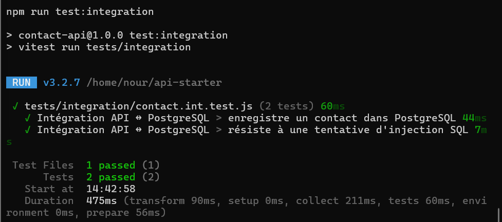

# TP8 : API Express sécurisée et testée

API de formulaire de contact (`POST /api/contact`) rendue robuste avec **Zod** (validation), **Helmet** (headers de sécurité) et **express-rate-limit** (limitation de débit), puis prouvée par des tests automatisés **Vitest + Supertest**, y compris un test d'intégration contre un vrai **PostgreSQL** (Docker Compose) avec migrations.

## Stack

Node.js 24 · Express 5 · Zod · Helmet · express-rate-limit · PostgreSQL 17 · Vitest · Supertest · Docker Compose

## Structure du projet

```
src/
  app.js                    fabrique createApp({ contactRepository })
  server.js                 point d'entrée
  migrate.js                applique les migrations SQL
  routes/                   health.js, contact.js
  schemas/contact.js        schéma Zod (.strict())
  middlewares/              validate.js, errorHandler.js
  repositories/             PostgreSQL (requêtes paramétrées) + mémoire
migrations/                 001_create_contacts.sql, 002_add_contacts_email_index.sql
tests/                      contact.test.js, health.test.js, integration/
captures/                   preuves (captures d'écran)
```

## Lancer le projet

```bash
npm install
cp .env.example .env                 # puis changer PGPASSWORD
set -a; . ./.env; set +a
docker compose up -d --wait
npm run migrate
npm start
npm test                             # tests de routes (repository en mémoire)
npm run test:coverage                # couverture
npm run test:integration             # API + PostgreSQL réel
```

---

## Partie 1 : OWASP API Security Top 10 (2023)

| Risque OWASP | Concerne notre API ? | Mesure dans ce TP |
|---|---|---|
| API1 Broken Object Level Authorization | Non : pas d'objets appartenant à un utilisateur, un seul POST public | n/a |
| API2 Broken Authentication | Partiellement : l'endpoint est public, sans authentification | Hors périmètre du TP (ajouter un jeton en production) |
| API3 Broken Object Property Level Authorization | Oui | `.strict()` refuse les champs en trop (mass assignment) |
| API4 Unrestricted Resource Consumption | Oui | Rate limiting (5 req/min/IP), taille max du corps (10 ko) |
| API8 Security Misconfiguration | Oui | Helmet, pas de stack trace, pas de `x-powered-by` |

### Trois attaques que la version de départ laissait passer

1. **Aucune validation** : n'importe quel contenu (champs manquants, mauvais types, champs en trop comme `isAdmin`) était accepté.
2. **Divulgation d'informations** : le middleware d'erreur renvoyait le message d'erreur et la **stack trace** au client.
3. **Consommation de ressources** : aucune limite de taille du corps ni de débit, donc une rafale de requêtes ou un gros corps pouvaient saturer l'API.

---

## Partie 2 : Validation et gestion des erreurs

Chaîne de middlewares : `helmet` → `rate limit` → `express.json` → `validate(schema)` → route → `errorHandler`.

Schéma Zod : `name` (trim, 2 à 100), `email` (format email, 254 max), `message` (10 à 2000), `.strict()`.

| Situation | Code | Corps |
|---|---|---|
| Message valide | 201 | `{ "id": 1, "status": "received" }` |
| Données invalides | 400 | `{ "error": "VALIDATION_ERROR", "details": [{ "field", "message" }] }` |
| JSON mal formé | 400 | `{ "error": "INVALID_JSON" }` |
| Corps supérieur à 10 ko | 413 | `{ "error": "PAYLOAD_TOO_LARGE" }` |
| Trop de requêtes | 429 | `{ "error": "TOO_MANY_REQUESTS" }` |
| Route inconnue | 404 | `{ "error": "NOT_FOUND" }` |
| Erreur interne | 500 | `{ "error": "INTERNAL_ERROR" }` (stack journalisée côté serveur uniquement) |

**Preuve : requête invalide et réponse `VALIDATION_ERROR` détaillée**



---

## Partie 3 : Durcissement HTTP

- `app.disable("x-powered-by")` puis `helmet()`
- `express.json({ limit: "10kb" })`
- `express-rate-limit` uniquement sur `/api/contact` : 5 requêtes par minute et par IP, headers `RateLimit-*` standard
- Derrière un reverse proxy (Nginx, Ingress) : ajouter `app.set("trust proxy", 1)`, sinon toutes les requêtes semblent venir de la même IP

**Preuve : `curl -I` avant / après Helmet**



**Preuve : boucle `curl` se terminant par des 429**



---

## Partie 4 : Tests de routes et cas négatifs

| Outil | Rôle |
|---|---|
| Vitest | Lanceur de tests et assertions |
| Supertest | Requêtes HTTP vers l'application sans ouvrir de port |
| Repository en mémoire | Remplace PostgreSQL dans les tests de routes |

Cas couverts : message valide, email invalide, champ manquant, champ supplémentaire, types inattendus, JSON tronqué, corps supérieur à 10 ko, injection SQL stockée telle quelle, erreur 500 sans stack ni message d'origine, headers Helmet, absence de `x-powered-by`, 429 après 5 requêtes, 404 JSON.

**Preuve : `npm test`, tous les tests passent, plus aucun `todo`**



**Preuve : rapport de couverture**



> `server.js`, `migrate.js` et le repository PostgreSQL apparaissent à 0 % dans ce rapport : ils sont exercés par le test d'intégration (partie 5), exclu de `npm run test:coverage`.

---

## Partie 5 : Intégration avec PostgreSQL et migrations

- `001_create_contacts.sql` : création de la table `contacts`
- `002_add_contacts_email_index.sql` : index sur `email`
- `npm run migrate` est **idempotent** : la table `schema_migrations` mémorise les migrations déjà appliquées, une 2e exécution ne fait rien.
- Les requêtes du repository sont **paramétrées** (`$1, $2, $3`) : une tentative d'injection SQL est stockée comme simple texte.

Tests d'intégration : un contact est enregistré puis relu en base ; une tentative d'injection SQL dans `name` laisse la table intacte et la valeur est stockée telle quelle.

**Preuve : `npm run test:integration` contre PostgreSQL**



---

## Livrables

| Fichier | Contenu |
|---|---|
| `captures/validation-400.png` | Requête invalide et réponse `VALIDATION_ERROR` |
| `captures/helmet-headers.png` | `curl -I` avant / après Helmet |
| `captures/rate-limit-429.png` | Boucle `curl` avec 429 |
| `captures/tests-ok.png` | `npm test` : tous les tests passent |
| `captures/coverage.png` | Rapport de couverture |
| `captures/integration-ok.png` | `npm run test:integration` |
| Code complété + tableau OWASP | Ce dépôt |
